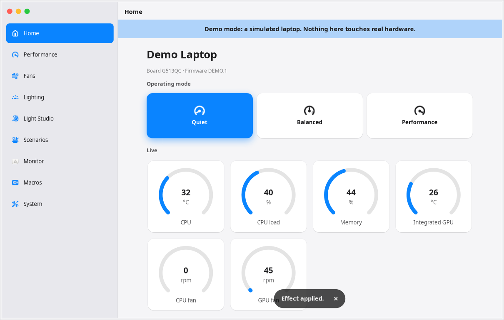

# OpenArmoury

A native Ubuntu app for ASUS gaming laptops: performance profiles, fan curves, battery charge limit and keyboard
lighting. It's an independent project, not made by or affiliated with ASUS.

It works out what your laptop can do when it starts, from what the kernel and keyboard report, rather than from a
list of supported models.



## Try it safely

Demo mode runs against a simulated laptop and can't touch your hardware or saved settings:

```sh
python3 -m openarmoury --demo
```

## Install

Needs Ubuntu 24.04 or newer with `python3-gi`, `gir1.2-gtk-4.0` and `gir1.2-adw-1`. Nothing is downloaded.

```sh
sudo ./install.sh                # or: sudo ./install.sh --no-uaccess
sudo ./uninstall.sh              # removes everything except your settings
```

### The `--no-uaccess` choice

The default install adds a udev rule so that lighting works without a password. That rule also lets programs
running as you read raw key reports from the keyboard. With `--no-uaccess` lighting goes through the root helper
instead, and asks for your password once a session.

## Pages

| Page | What it does |
|---|---|
| Home | Operating mode tiles, live gauges for temperature, load, memory and fans, and status |
| Performance | Profile, GPU settings with warnings, and power limits with the kernel's own min and max |
| Fans | Drag-to-edit curves with 8 points per fan, re-applied when you return to a profile |
| Lighting | Built-in effects, colour, speed, direction, zones, brightness, and boot/sleep lighting, with an animated preview |
| Light Studio | Painting, a keyframe editor, sensor-driven and music-reactive lighting, and presets |
| Scenarios | Settings per game or program, plugged-in and battery rules, and a game library |
| Monitor | Live CPU, memory, disk, network and power, GPU state without waking it, and closing large programs |
| Macros | Record keys, then play them back from a button or a keyboard shortcut |
| System | Battery care, touchpad, Win key, microphone, refresh rate, night light, ROG key, background running, and backups |

[docs/features.md](docs/features.md) compares every Armoury Crate feature, including what isn't built and why.

## How it stays safe

- **You see every first write.** The first time the app makes a kind of change, it shows the exact file or packet
  and waits for you. Anything unproven says why.
- **One small root helper.** It starts through `pkexec`, allows only exact paths and value patterns, and only talks
  to hidraw devices with the ASUS vendor ID. Firmware-style commands are refused.
- **Nothing is saved to the keyboard unless you ask.** Animations send only non-persistent colour packets, at no
  more than 15 frames a second.
- **The discrete GPU is left alone.** `nvidia-smi` is never called and its sensors are never read, so it isn't woken.

## Verified vs untested

Tested on one machine: ROG Strix G513QC, BIOS 331, kernel 7.0, Ubuntu 24.04.5.

| Status | What |
|---|---|
| **Tested automatically** | HID descriptor parser using this laptop's real descriptor; helper whitelist; packet layouts; restore rules (`pytest`) |
| **Tested on the mock laptop** | Every page, helper writes, the approval dialog, the live-lighting rate limit, scenarios, macros and power states (`tests/shots.py`, under Xvfb) |
| **Checked on the real laptop, read-only** | Model, sensors, fans, curves, profiles, attributes, keyboard interface, GPU state, refresh rates and battery health read correctly (`tests/real_readonly.py`) |
| **Worked on the real laptop** | `install.sh`, the keyboard query and applying a built-in effect, according to the saved settings |
| **Not yet tested on real hardware** | Profile, fan curve, charge limit and GPU writes; direct and live lighting; power states; macros; refresh rate change; touchpad, Win key and ROG key settings; background running |
| **Unproven protocol details** | Which packet saves to flash; direct colour on this model; zone numbers; see [docs/protocol.md](docs/protocol.md) |
| **Other ASUS laptops** | Untested. Model data comes from asusctl, and detection is designed to fall back to fewer features |

### Known limits

- Per-key painting needs a key layout. asusctl provides 18. A per-key model without one gets everything else, but
  no key painting.
- Lighting power states (boot and sleep) on older keyboards come from asusctl only, so they show a warning first.
- The Win key setting only stops Activities opening. Win+ shortcuts still work.
- Refresh rate control needs GNOME. Scenarios and battery rules need the app running, or "Keep running" on.
- Macros play through the root helper, so they may ask for your password. They're stored as plain text.
- Restoring at login asks for your password if it has to change anything besides lighting. Software effects
  from Light Studio need the app running.
- CPU power limits show as unavailable where the kernel has no limits for your model, which includes the G513QC.

## Development

```sh
python3 -m pytest tests
xvfb-run -a -s "-screen 0 1280x900x24" env GSK_RENDERER=cairo python3 tests/shots.py docs/screenshots
```

## Licence and credits

Keyboard layouts and the model table in `openarmoury/data/asusctl/` are converted from
[asusctl](https://github.com/opengamingcollective/asusctl) and stay under the Mozilla Public License 2.0, with the
licence alongside them. `scripts/import_asusctl.py` regenerates them.

The app icon was generated with Gemini. Check Google's terms for AI-generated images before publishing it.
`scripts/make_icons.py` rebuilds the sizes from `data/icons/source.jpeg`.

The rest of the project has no licence chosen yet.
