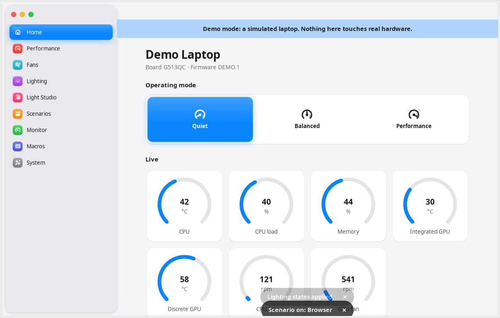
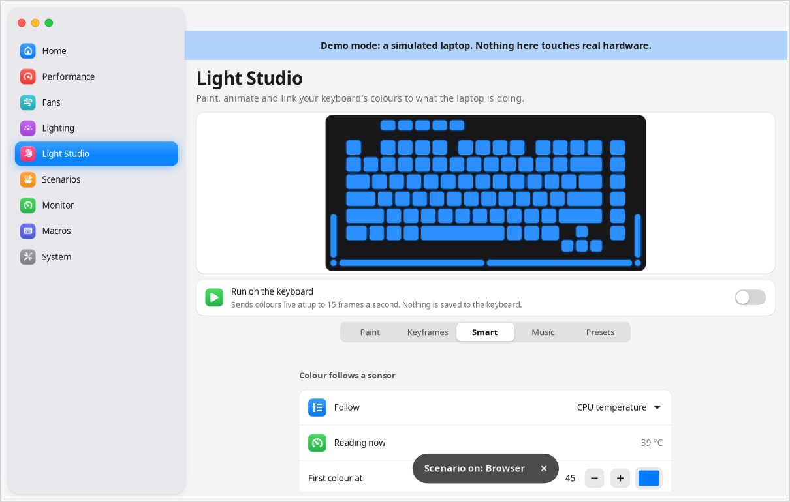

<p align="center"></p>

<h1 align="center">OpenArmoury</h1>

<p align="center">A native Ubuntu control centre for ASUS gaming laptops.</p>

ASUS's Armoury Crate and Aura Creator only run on Windows. OpenArmoury brings their useful laptop controls to Linux:
performance modes, fan curves, battery limits and keyboard lighting, in one app.

It works out what your laptop can do when it starts, from what the kernel and keyboard report, rather than from a
fixed list of supported models.

> OpenArmoury is an independent project. It isn't made by, or affiliated with, ASUS. Armoury Crate and Aura are ASUS
> names, used here only to describe what this project is an alternative to.



## Install

You need Ubuntu 24.04 or newer, with GNOME for the full feature set.

1. Download `openarmoury_0.1.0_all.deb` from this repo's Releases page.
2. In the folder where you saved it, run:

   ```sh
   sudo apt install ./openarmoury_0.1.0_all.deb
   ```

3. Open **OpenArmoury** from your apps.

To remove it, run `sudo apt remove openarmoury`. Your settings stay in `~/.config/openarmoury` until you delete them.

### Try it without changing anything

Demo mode runs on a simulated laptop, and can't touch your hardware or settings:

```sh
openarmoury --demo
```

### Other ways to install

To build the package yourself, run `scripts/build_deb.sh`, and the file appears in `dist/`.

To install directly from a copy of this repo, run `sudo ./install.sh --no-uaccess`. Without `--no-uaccess`, it also
adds a rule that lets lighting work without a password, but that rule lets programs running as you read raw key
presses from the keyboard. The package leaves this rule out. Use `sudo ./uninstall.sh` to remove this kind of install.

## Features

| Page | What you can do |
|---|---|
| **Home** | Switch operating mode, and see live temperature, load, memory and fan dials |
| **Performance** | Choose a profile, turn off the discrete GPU in safe steps, and set power limits where the kernel offers them |
| **Fans** | Drag 8 points per fan to shape a curve, or start from Quiet, Balanced, Cool or Full speed |
| **Lighting** | Set effects, colour, speed, direction, zones and brightness, and choose when the lights stay on |
| **Light Studio** | Paint keys or zones, build keyframe animations, and link colour to temperature, load, battery or music |
| **Scenarios** | Change settings per game or program, set plugged-in and battery rules, and launch games |
| **Monitor** | Watch CPU, memory, disk, network and power, plus NVIDIA readings, and close large programs |
| **Macros** | Record keys, then replay them from a button or keyboard shortcut |
| **System** | Set battery care limits, touchpad, Win key, microphone, refresh rate and night light, and back up your settings |

Light and dark themes follow your system. [docs/features.md](docs/features.md) compares every Armoury Crate feature,
including what isn't built and why.



## How it stays safe

- **You see every first change.** The first time the app makes a kind of change, it shows the exact file or packet and
  waits for your OK. Anything unproven says why.
- **One small root helper.** It starts through `pkexec` and allows only exact paths and values. It talks only to
  hidraw devices with the ASUS vendor ID, and refuses firmware-style commands.
- **Nothing is saved to the keyboard unless you ask.** Animations send only temporary colour packets, at up to 15
  frames a second.
- **A sleeping GPU stays asleep.** `nvidia-smi` runs only when the GPU is already awake, and rarely enough when idle
  that it can go back to sleep.
- **The GPU can't be switched off with its driver loaded.** That crashed the kernel when tested, so both the app and
  the helper refuse it.

## What's been tested

Everything was tested on one laptop: a ROG Strix G513QC with BIOS 331, kernel 7.0 and Ubuntu 24.04.5.

| Status | What |
|---|---|
| ✅ **Works on the real laptop** | Profiles, charge limit, brightness, boot sound, panel overdrive, fan curves, keyboard effects, zone and live colour, macros, NVIDIA readings, touchpad, Win key, microphone, night light, refresh rate, scenarios, plugged-in rules, running in the background, and music lighting |
| ⚠️ **Sent, but the result isn't confirmed** | Saving an effect to keyboard memory, and boot and sleep lighting |
| ⚠️ **Not tested on a real laptop** | The two-step way to turn off the GPU, battery rules, and the game library, which has only seen a demo entry and a sample Steam game |
| ❌ **Found unsafe, so blocked** | Turning off the GPU while its driver is loaded |
| ❓ **Other ASUS laptops** | Untested. The app is designed to fall back to fewer features, but expect rough edges |

Reports from other models are very welcome.

### Known limits

- Per-key painting needs a key layout, and 18 are included. A per-key laptop without one gets everything else.
- The Win key setting stops Activities opening, but Win+ shortcuts still work.
- Refresh rate, touchpad, Win key, night light and shortcuts need GNOME.
- Scenarios and rules need the app running, or **Keep running** turned on in System.
- Restoring settings at login asks for your password unless lighting is all that's saved.
- If you turn off the GPU, it also stays off in Windows until you turn it back on from the app.

## How this was built

1. **Surveyed the hardware** using read-only commands: [docs/hardware.md](docs/hardware.md).
2. **Studied the protocol** through static analysis of Armoury Crate's installed files, for interoperability, and
   cross-checked each fact against [asusctl](https://github.com/opengamingcollective/asusctl) and the Linux kernel
   drivers: [docs/protocol.md](docs/protocol.md). No ASUS code or assets are in this project.
3. **Built the app** in Python with GTK4 and libadwaita. It uses kernel interfaces wherever they exist, and hidraw
   only for keyboard lighting.
4. **Tested it** on a simulated laptop first, then on real hardware, restoring settings afterwards.

## Development

```sh
python3 -m pytest tests                        # logic and the helper's safety rules
xvfb-run -a -s "-screen 0 1280x900x24" env GSK_RENDERER=cairo python3 tests/shots.py /tmp/openarmoury-shots   # every page, on the simulated laptop
python3 tests/real_write_check.py              # real writes on your laptop, then restores them
scripts/build_deb.sh                           # builds the package
```

## Licence and credits

Keyboard layouts and the model table in `openarmoury/data/asusctl/` are converted from
[asusctl](https://github.com/opengamingcollective/asusctl) and stay under the Mozilla Public License 2.0, with the
licence alongside them. `scripts/import_asusctl.py` regenerates them.

The app icon was generated with Gemini. `scripts/make_icons.py` rebuilds its sizes from `data/icons/source.jpeg`.

The rest of the project has no licence chosen yet.
